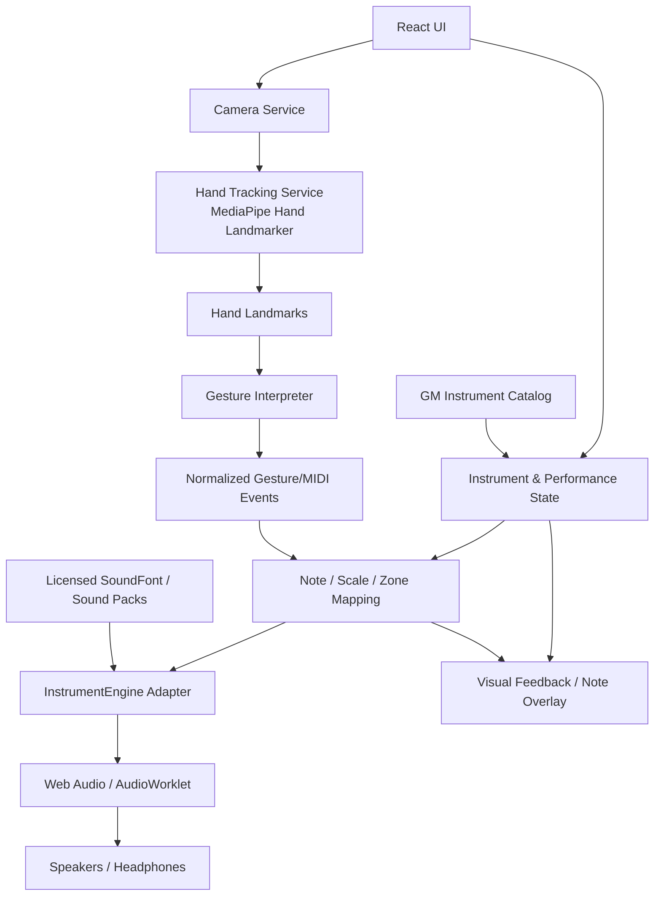

# Arsitektur Proyek — Virtual Instrument Berbasis Gerakan Tangan

> Dokumen fondasi untuk repository baru. Dokumen ini mendefinisikan rancangan teknis awal, batasan, struktur kode, alur audio/gesture, serta strategi deploy ke Vercel. Implementasi sebaiknya mengikuti dokumen ini dan memperbaruinya saat keputusan arsitektur berubah.

- **Status:** Diimplementasikan (v1.0). Bagian bertanda *Implementasi* mencatat keputusan aktual; lihat juga §16.
- **Target deploy:** Vercel (static frontend)
- **Pendekatan:** Browser-first, client-side processing
- **Sasaran instrumen:** 128 program General MIDI (GM) sebagai katalog dasar, ditambah sound pack opsional
- **Sasaran perangkat:** Desktop/laptop lebih dulu; tablet dan perangkat mobile sebagai peningkatan kompatibilitas

---

## 1. Ringkasan Proyek

Aplikasi web musik virtual yang memungkinkan pengguna memainkan instrumen dengan gerakan tangan di depan kamera. Kamera melacak posisi dan landmark tangan; lapisan interpretasi gesture menerjemahkan gerakan tersebut menjadi perintah note-on, note-off, perubahan program instrumen, dan kontrol audio. Mesin synthesizer memproses pesan itu menjadi suara melalui browser.

### Tujuan utama

1. Memainkan suara secara interaktif dengan latensi serendah mungkin.
2. Mendukung katalog 128 program General MIDI melalui SoundFont yang sesuai.
3. Menggunakan kamera secara lokal di perangkat pengguna; frame kamera tidak dikirim ke backend aplikasi.
4. Menjaga modul pelacakan tangan, pemetaan gesture, katalog instrumen, dan audio engine tetap terpisah.
5. Dapat di-deploy sebagai aplikasi frontend statis di Vercel tanpa server yang selalu aktif.
6. Memungkinkan instrumen tambahan ditambahkan lewat katalog/paket suara tanpa menulis ulang sistem gesture.

### Bukan sasaran versi awal

- Akun pengguna, login, database, sinkronisasi cloud, atau multiplayer real-time.
- DAW penuh atau sequencer profesional.
- Menjamin semua jenis alat musik di dunia tersedia pada rilis pertama. General MIDI menyediakan 128 program standar; instrumen di luar standar memerlukan sound pack tambahan.
- Menjamin semua komputer menghasilkan kualitas audio atau frame rate yang sama. Performa bergantung pada browser, CPU/GPU, webcam, dan ukuran sound bank.

---

## 2. Keputusan Arsitektur

| Area | Pilihan awal | Alasan |
|---|---|---|
| Framework | React 19 + Vite 8 + TypeScript 6 (strict, `noUncheckedIndexedAccess`) | Frontend modular, build statis, tipe data untuk event gesture/audio |
| Styling | Tailwind CSS 4 (`@tailwindcss/vite`) | UI dapat dikembangkan cepat dan konsisten |
| Kualitas | oxlint (template resmi Vite), Prettier, Vitest, Playwright | Lint cepat; unit test logika; e2e di Chromium nyata dengan kamera palsu |
| State UI | Store kecil berbasis `useSyncExternalStore` (`src/state`) | Tanpa dependensi tambahan; data per-frame tidak lewat React |
| Hand tracking | MediaPipe Tasks Vision — Hand Landmarker | Menghasilkan landmark tangan dari video di browser |
| Audio engine | Adapter `InstrumentEngine`; proof of concept dengan `spessasynth_lib` | Dapat memuat SoundFont SF2/SF3/DLS dan mengirim pesan program/note melalui Web Audio; adapter mencegah aplikasi bergantung langsung pada satu library |
| Audio worklet | AudioWorklet yang disediakan engine bila konfigurasi engine memerlukannya | Membantu pemrosesan audio terpisah dari UI dan mengurangi gangguan akibat pekerjaan main thread |
| Musik dan instrumen | Data metadata sendiri + SoundFont yang lisensinya telah diverifikasi | Metadata katalog dipisahkan dari data suara; mudah mengganti atau menambah sound bank |
| Hosting | Vercel static deployment | Tidak memerlukan backend untuk interaksi kamera dan audio dasar |
| Penyimpanan setelan | LocalStorage, opsional | Menyimpan instrumen terakhir, skala, rentang nada, volume, dan preferensi UI di perangkat |

**Catatan pemilihan audio engine:** implementasi awal harus menguji `spessasynth_lib` dengan satu SoundFont GM yang sah dan ukurannya realistis. Alternatif seperti WebAudioFont juga bisa dipertimbangkan, tetapi lisensi library, SoundFont, dan sample harus diperiksa secara terpisah sebelum dipilih. Jangan menganggap lisensi engine otomatis mencakup lisensi semua aset suara.

---

## 3. Diagram Komponen



### Alur pada saat dimainkan

1. Pengguna menekan tombol **Mulai**. Browser meminta izin kamera.
2. Aplikasi membuat `AudioContext`/engine setelah interaksi pengguna untuk memenuhi kebijakan autoplay browser.
3. Video dari kamera diteruskan ke Hand Landmarker.
4. Landmark hasil tracking diteruskan ke `GestureInterpreter` untuk menghitung posisi, pinch/open state, kecepatan gerak, dan confidence.
5. `NoteMapper` memetakan interaksi menjadi nomor note MIDI sesuai mode, oktaf, key, dan skala yang dipilih.
6. `InstrumentEngine` mengirim `noteOn`/`noteOff` ke synthesizer. Program instrumen aktif menentukan suara yang dimainkan.
7. UI memperlihatkan posisi tangan, note yang aktif, status kamera/audio, dan instrumen terpilih.
8. Saat pengguna berhenti, semua note aktif dilepas, kamera dihentikan, dan resource audio/tracking dibersihkan.

---

## 4. Arsitektur Modul

### 4.1 UI Layer

Tanggung jawab:

- Halaman utama dan layout responsif.
- Tombol mulai/berhenti kamera dan audio.
- Pemilih instrumen, kategori, oktaf, key, skala, volume, dan mode bermain.
- Panel status: kamera, model tracking, audio engine, bank suara, dan pesan error.
- Visual feedback: overlay landmark/hand pointer, keyboard/zona nada, indikator note aktif.
- Pengaturan aksesibilitas dan kontrol alternatif melalui mouse/keyboard.

UI tidak boleh mengakses library MediaPipe atau synthesizer langsung dari banyak komponen. Komponen UI memanggil service/hook yang menjadi pintu masuk ke modul tracking dan audio.

### 4.2 Camera Service

Tanggung jawab:

- Meminta akses kamera melalui `navigator.mediaDevices.getUserMedia`.
- Memilih resolusi/facing mode yang sesuai perangkat.
- Menampilkan video ke elemen `<video>`; video preview boleh di-mirror untuk pengalaman pengguna.
- Menangani izin ditolak, kamera tidak tersedia, kamera sedang dipakai aplikasi lain, dan device terputus.
- Menghentikan semua `MediaStreamTrack` saat sesi berakhir atau komponen dilepas.

Kamera hanya diproses secara lokal untuk fitur permainan. Jangan membuat upload atau penyimpanan frame kamera tanpa persetujuan dan desain privasi baru.

### 4.3 Hand Tracking Service

Gunakan MediaPipe Hand Landmarker untuk memperoleh landmark tangan dari video.

Kontrak konseptual:

```ts
export interface HandTrackingService {
  initialize(): Promise<void>;
  start(video: HTMLVideoElement): Promise<void>;
  stop(): Promise<void>;
  dispose(): Promise<void>;
  onResults(callback: (result: HandTrackingResult) => void): () => void;
}
```

`HandTrackingResult` harus menjadi tipe internal aplikasi, tidak menyebarkan bentuk object MediaPipe ke semua modul.

Prinsip performa:

- Proses hanya saat `video.currentTime` berubah.
- Batasi jumlah tangan yang dilacak sesuai kebutuhan awal; mulai dari maksimum dua tangan.
- Hindari membuat object/array besar baru pada setiap frame jika tidak diperlukan.
- Pisahkan loop tracking dari render UI agar React tidak melakukan render penuh per frame.
- Karena inferensi video bisa memblokir main thread, ukur kelancaran versi awal. Jika UI terasa tersendat, pindahkan inferensi ke Web Worker bila setup model/runtime yang dipilih mendukungnya.
- Sediakan kualitas tracking rendah/normal untuk perangkat berbeda jika hasil pengujian memerlukannya.

### 4.4 Gesture Interpreter

Modul ini mengubah landmark menjadi event bermakna tanpa memutuskan suara instrumen tertentu.

Contoh event internal:

```ts
export type GestureEvent =
  | { type: "pointer-move"; handId: string; x: number; y: number; confidence: number; timestamp: number }
  | { type: "pinch-start"; handId: string; x: number; y: number; confidence: number; timestamp: number }
  | { type: "pinch-end"; handId: string; timestamp: number }
  | { type: "swipe"; handId: string; direction: "left" | "right" | "up" | "down"; velocity: number; timestamp: number }
  | { type: "hand-lost"; handId: string; timestamp: number };
```

Parameter seperti ambang pinch, smoothing, debounce, confidence minimum, dan cooldown harus menjadi konfigurasi yang bisa diatur atau diuji—bukan magic number tersebar di kode.

Rekomendasi deteksi:

- Gunakan smoothing ringan untuk mengurangi jitter landmark.
- Terapkan **hysteresis**: ambang mulai pinch dan ambang lepas pinch berbeda agar note tidak berulang kali menyala/mati dekat batas deteksi.
- Abaikan gesture dengan confidence rendah.
- Ketika tangan hilang, lepaskan semua note yang dimiliki tangan tersebut agar suara tidak menggantung.
- Simpan note aktif berdasarkan pasangan `handId + noteNumber`, supaya note-off dari satu tangan tidak menghentikan note identik milik tangan lain secara tidak sengaja.

### 4.5 Note Mapper / Music Theory

Memetakan posisi/gesture menjadi note MIDI.

Tanggung jawab:

- Mengubah koordinat horizontal menjadi key/zona atau rentang note.
- Memetakan posisi ke note MIDI dan label notasi (misalnya C4, F♯4).
- Mendukung mode kromatis, major, minor natural, major pentatonic, dan minor pentatonic.
- Mengatur root/key, oktaf, rentang nada, serta quantization ke skala.
- Membedakan interaksi `noteOn` dan `noteOff` serta mencegah note yang sama terpicu berkali-kali saat pointer tidak berpindah zona.
- Menghasilkan nomor MIDI, bukan memakai label UI sebagai identitas note.

Definisi awal:

- Nomor note MIDI: bilangan 0–127.
- Nama notasi menggunakan satu konvensi konsisten, dengan pilihan enharmonic untuk tampilan jika diperlukan.
- Rentang default prototipe: C3–B5 (bisa diubah pengguna); jangan menganggap rentang ini sebagai batas synthesizer.
- Skala menentukan note valid; mode kromatis memperbolehkan seluruh 12 semiton.

### 4.6 Instrument Catalog

Buat katalog metadata terpisah dari file suara.

Contoh struktur data:

```ts
export interface InstrumentDefinition {
  id: string;
  name: string;
  category: InstrumentCategory;
  source: "general-midi" | "custom-pack";
  programNumber?: number; // General MIDI 0-based: 0..127
  bankNumber?: number;
  soundBankId: string;
  icon?: string;
  description?: string;
  tags: string[];
  available: boolean;
}
```

Aturan katalog GM:

- Daftarkan seluruh **128 program GM** dengan indeks standar **0–127** di kode.
- Bila label yang ditampilkan memakai nomor 1–128, konversikan pada layer UI saja dan dokumentasikan jelas agar tidak terjadi off-by-one.
- Nama/kategori preset mengikuti tabel GM yang dipilih dan konsisten.
- `available` menandakan preset benar-benar tersedia dalam SoundFont yang aktif; metadata 128 nama saja tidak menjamin SoundFont memiliki kualitas atau variasi yang seragam.
- Custom pack menggunakan ID unik dan tidak merusak ID program GM.
- Katalog instrumen dan konfigurasi SoundFont harus menyediakan fallback jika preset tidak tersedia.

### 4.7 Instrument Engine Adapter

Semua kontrol synthesizer harus melalui satu interface internal supaya engine bisa diganti tanpa menulis ulang UI atau gesture system.

```ts
export interface InstrumentEngine {
  initialize(): Promise<void>;          // dipanggil dari handler klik
  resume(): Promise<void>;
  loadSoundBank(o: SoundBankLoadOptions): Promise<PresetInfo[]>; // URL atau buffer, bankOffset, progres
  removeSoundBank(id: string): Promise<void>;
  getPresets(): PresetInfo[];
  selectPatch(channel: number, patch: MidiPatch): void; // bank MSB/LSB + program 0–127
  setChannelIsDrum(channel: number, isDrum: boolean): void;
  noteOn(channel: number, note: number, velocity: number, time?: number): void;
  noteOff(channel: number, note: number, time?: number): void;
  controlChange(channel: number, cc: number, value: number, time?: number): void;
  setVolume(value: number): void;
  setEffects(e: EffectSettings): void;
  channelNotesOff(channel: number, time?: number): void;
  allNotesOff(): void;
  currentTime(): number;                // jam audio untuk penjadwalan presisi (metronom/looper)
  getOutputLevel(): number;
  getSnapshot(): EngineSnapshot;
  subscribe(l: (s: EngineSnapshot) => void): () => void;
  dispose(): Promise<void>;
}
```

*Implementasi:* kontrak di atas (`src/services/audio/InstrumentEngine.ts`) menggantikan draf awal. Pemetaan `instrumentId → patch` dilakukan oleh katalog (`instrumentPatch`) di controller, sehingga engine tetap tidak tahu soal ID UI. Parameter `time` dipakai metronom dan looper untuk penjadwalan lookahead pada jam AudioContext. Implementasi: `SpessaSynthEngine` (AudioWorklet; graf `synth → low-pass → dry + delay → master → analyser`) dan `MockInstrumentEngine` untuk test.

Implementasi adapter harus menangani pemetaan `instrumentId` ke bank/program MIDI, pengaturan kanal, status loading, error saat SoundFont gagal dimuat, dan pelepasan resource. API di atas bersifat kontrak internal; sesuaikan detail implementasi setelah proof of concept dengan versi library yang benar-benar dipasang.

**Keputusan penting:** jangan menginisialisasi ulang AudioContext/Synthesizer setiap kali instrumen diganti. Pertahankan engine aktif dan ubah program/channel bila didukung. Pastikan note aktif dilepas sebelum pergantian instrumen bila pergantian program dapat mengubah suara note yang sedang berbunyi.

### 4.8 Drum Mode

Mode drum berbeda dari mode melodi. Drum menggunakan event pukulan yang memicu nomor note drum General MIDI pada drum channel sesuai spesifikasi engine/SoundFont.

Desain awal:

- Zona gesture dipetakan ke kick, snare, closed/open hi-hat, tom, crash, dan ride.
- Kecepatan gesture dapat memengaruhi velocity.
- Sediakan cooldown per zona untuk menghindari satu pukulan menghasilkan banyak hit.
- Gunakan bank/kit drum yang benar-benar tersedia di sound bank.
- Jangan memperlakukan suara drum sebagai skala C3–B5 seperti instrumen melodis.

### 4.9 Settings dan Persistence

LocalStorage hanya untuk preferensi yang tidak sensitif, misalnya:

- Instrumen terakhir.
- Mode permainan, root/key, skala, dan oktaf.
- Volume/master gain dan preferensi tampilan.
- Preferensi overlay kamera.

Jangan menyimpan gambar kamera, video, template biometrik, atau data landmark personal.

---

## 5. Model Interaksi

### Mode A — Air Piano / Melodic Instrument

- Posisi telunjuk atau titik kontrol tangan menentukan nada/zona.
- Pinch ibu jari–telunjuk memulai note (`noteOn`); membuka pinch melepaskan note (`noteOff`).
- Perpindahan posisi saat pinch ditahan dapat mempertahankan note lama dan memulai note baru, mengikuti mode yang dipilih.
- Note hanya berubah ketika zona note berubah, bukan pada setiap frame.
- Tampilkan nama note dan zona yang sedang dipilih.

### Mode B — Scale Play

- Pengguna menentukan root/key dan skala.
- Posisi tangan di-snap ke note valid dalam skala.
- Opsional: tombol **Quantize to scale** untuk mengurangi kemungkinan note di luar skala.

### Mode C — Air Drums

- Gerakan cepat atau gesture serang melewati zona drum memicu sampel.
- Velocity berasal dari estimasi kecepatan gerak yang telah difilter.
- Terapkan cooldown dan indikator visual agar pukulan mudah dipahami.

### Kontrol alternatif

Sediakan keyboard komputer atau klik UI untuk menguji instrumen saat kamera tidak tersedia, melakukan debug audio, serta meningkatkan aksesibilitas. Kontrol alternatif bukan pengganti fitur gesture utama.

---

## 6. Strategi General MIDI dan SoundFont

### General MIDI bukan file suara

GM adalah standar pemetaan program instrumen dan drum. Suara aktual disediakan oleh SoundFont/sound bank atau sampler. Karena itu, katalog 128 preset memerlukan sound bank yang benar-benar mencakup program yang diperlukan.

### Strategi aset audio

1. Mulai dengan satu SoundFont GM yang mendukung program instrumen dan drum yang dibutuhkan.
2. Catat nama sumber, versi, lisensi, atribusi, dan URL sumber pada `THIRD_PARTY_NOTICES.md`.
3. Verifikasi apakah SoundFont boleh di-redistribusi dan di-host pada situs publik sebelum dimasukkan ke repository atau deploy.
4. Jangan mengunduh/memasukkan sound pack tanpa memeriksa lisensinya.
5. Muat bank secara lazy saat pengguna memulai audio atau memilih keluarga instrumen; tampilkan progress loading.
6. Cache hasil yang sesuai bila memungkinkan, tetapi tangani cache kosong, expired, dan kegagalan jaringan.
7. Bila ukuran sound bank mendekati batas deploy, pindahkan aset ke penyimpanan file/CDN yang sesuai dan gunakan URL berversi dengan CORS yang benar. Jangan memaksa satu file besar masuk ke source bundle.

### Pilihan hosting suara

- **Pilihan awal:** file SoundFont yang lisensinya jelas dan ukurannya muat dalam batas deploy. Ini memudahkan CORS dan pengelolaan versi.
- **Bila aset terlalu besar:** host di object storage/CDN eksternal, lalu ambil URL dari konfigurasi publik. Pastikan CORS mengizinkan origin aplikasi dan cache header tidak membuat versi lama tertahan.
- Jangan memasukkan kredensial rahasia ke frontend. Variabel `VITE_*` dapat terekspos ke browser dan bukan tempat menyimpan secret.

Periksa kembali batas Vercel terbaru saat deploy. Dokumentasi Vercel saat penulisan ini menyebutkan batas upload file statis/source tertentu menurut metode deploy dan paket; batas tersebut harus dianggap sebagai guardrail yang perlu diverifikasi, bukan angka permanen.

---

## 7. Struktur Folder yang Disarankan

```text
.
├── public/
│   ├── models/
│   │   └── hand_landmarker.task        # model MediaPipe yang lisensinya sesuai
│   ├── audio/
│   │   ├── soundfonts/                 # hanya bila ukuran & lisensi mengizinkan
│   │   └── previews/                   # preview pendek bila diperlukan
│   ├── favicon.svg
│   └── robots.txt
├── src/
│   ├── app/
│   │   ├── App.tsx
│   │   ├── routes.tsx                  # opsional jika aplikasi memakai routing
│   │   └── providers/
│   ├── components/
│   │   ├── layout/
│   │   ├── camera/
│   │   ├── instrument-picker/
│   │   ├── music-controls/
│   │   ├── note-visualizer/
│   │   └── status/
│   ├── features/
│   │   ├── performance/
│   │   ├── hand-tracking/
│   │   ├── instruments/
│   │   ├── music-theory/
│   │   └── drum-mode/
│   ├── services/
│   │   ├── camera/
│   │   ├── tracking/
│   │   ├── audio/
│   │   │   ├── InstrumentEngine.ts
│   │   │   └── SpessaSynthEngine.ts
│   │   └── storage/
│   ├── data/
│   │   ├── instruments/
│   │   │   ├── gm-programs.ts           # 128 program metadata
│   │   │   └── custom-instruments.ts
│   │   ├── scales.ts
│   │   └── drum-map.ts
│   ├── hooks/
│   ├── workers/
│   │   └── hand-tracking.worker.ts      # dibuat jika diperlukan dan runtime mendukung
│   ├── types/
│   ├── utils/
│   ├── styles/
│   └── main.tsx
├── tests/
│   ├── unit/
│   └── e2e/
├── docs/
│   ├── arsitektur.md
│   └── keputusan-teknis.md              # opsional: ADR untuk keputusan besar
├── .env.example
├── .gitignore
├── index.html
├── package.json
├── tsconfig.json
├── vite.config.ts
├── eslint.config.js
├── README.md
└── THIRD_PARTY_NOTICES.md
```

Catatan: jika `arsitektur.md` diletakkan di root repository, sesuaikan referensi di atas dan jangan membuat salinan berbeda di `docs/` tanpa alasan.

---

## 8. Strategi Vercel Deployment

Aplikasi awal sebaiknya dibangun sebagai frontend statis. Deteksi gesture dan audio berjalan di browser sehingga API/serverless functions tidak dibutuhkan untuk core gameplay.

### Konfigurasi build

- **Framework preset:** Vite
- **Install command:** `npm install` (atau package manager yang dikunci di repository)
- **Build command:** `npm run build`
- **Output directory:** `dist`
- **Node version:** gunakan versi LTS yang didukung tooling dan pin di konfigurasi project bila perlu.

### Kebutuhan produksi

- Aplikasi harus menggunakan HTTPS agar akses kamera bekerja pada domain produksi.
- Buat tombol eksplisit untuk memulai kamera/audio; browser dapat memblokir audio autoplay.
- Asset model dan sound bank harus tersedia pada path publik yang valid dan diuji di Preview Deployment maupun Production.
- Hindari path absolut yang hanya bekerja di localhost; uji base path dan URL asset di deployment preview.
- Tambahkan error UI untuk kamera ditolak, model gagal dimuat, sound bank gagal dimuat, browser tidak kompatibel, dan audio belum diaktifkan.
- Vercel Preview Deployments dapat digunakan untuk memeriksa perubahan lewat pull request sebelum production.
- Tidak perlu menambah database, auth provider, atau API route sampai terdapat kebutuhan produk yang jelas.

### Ukuran deploy dan asset

- Jangan membundel seluruh sample library duplikat ke JavaScript bundle.
- Jangan memuat semua sound bank sekaligus.
- Ukur ukuran akhir `dist/` sebelum rilis.
- Jika aset perlu dipisah ke CDN/object storage, versi URL asset dan uji CORS, cache, 404, dan kegagalan jaringan.

---

## 9. Privasi dan Keamanan

1. Minta izin kamera hanya ketika pengguna memilih untuk memulai.
2. Tampilkan indikator saat kamera aktif dan tombol yang jelas untuk menghentikannya.
3. Proses frame kamera di sisi klien; jangan mengirim frame ke endpoint aplikasi.
4. Dokumentasikan penggunaan MediaPipe. Dokumentasi MediaPipe menyatakan pemrosesan input Task berlangsung on-device, tetapi metrik penggunaan/performa tertentu dapat dikirim oleh library; tinjau dokumentasi dan kewajiban pemberitahuan privasi sesuai versi yang digunakan.
5. Jangan simpan frame, landmark, atau rekaman sesi secara default.
6. Validasi URL sound pack/konfigurasi publik sebelum digunakan; jangan menyediakan arbitrary URL loading dari input pengguna pada versi awal.
7. Kunci versi dependency dan periksa advisories sebelum rilis.
8. Simpan catatan lisensi engine, model AI, SoundFont, sample audio, icon, font, dan aset desain di `THIRD_PARTY_NOTICES.md`.

---

## 10. Performa dan Stabilitas

### Target awal untuk pengujian

Target berikut adalah sasaran internal, bukan jaminan pada semua perangkat:

- UI tetap responsif ketika tracking aktif.
- Gesture tidak memicu note berulang ketika tangan diam di satu zona.
- Tidak ada note menggantung setelah tangan hilang, kamera dimatikan, instrumen diganti, atau sesi dihentikan.
- Audio mulai setelah interaksi pengguna dan tidak dibuat ulang tiap render.
- Hanya instrumen/sound bank yang dibutuhkan yang dimuat.
- Penggunaan CPU, memori, dan waktu loading diuji pada setidaknya satu perangkat kelas menengah dan satu perangkat lebih rendah.

### Teknik penting

- Pisahkan state UI yang jarang berubah dari data landmark yang berubah setiap frame.
- Simpan loop tracking di service/ref/worker, bukan memicu React state update untuk setiap frame.
- Terapkan throttling, smoothing, hysteresis, dan cooldown yang dapat dikonfigurasi.
- Pastikan `allNotesOff()` dipanggil saat cleanup dan saat sesi mengalami error.
- Cache objek synthesizer dan SoundFont selama sesi bila aman.
- Tangani pergantian tab, browser suspend, perubahan device, dan perangkat yang kehilangan kamera.

---

## 11. Pengujian dan Kriteria Penerimaan

### Unit test

- Mapping koordinat ke note MIDI pada batas kiri/kanan.
- Konversi note MIDI ke label nada dan oktaf.
- Mapping skala: note yang dipilih termasuk dalam skala saat quantization aktif.
- Mapping `programNumber` GM 0–127 tanpa off-by-one.
- Pinch start/end tidak menghasilkan note-on berulang.
- `hand-lost` melepaskan semua note milik tangan tersebut.
- Pergantian instrumen tidak meninggalkan note aktif.
- Drum zones menerapkan cooldown dan menghasilkan note drum yang diharapkan.

### Integrasi audio

- Memuat SoundFont pilihan dan menunggu status siap.
- Memainkan satu note, melepas note, dan memainkan chord.
- Mengganti beberapa program dari keluarga berbeda (piano, guitar, strings, synth, reed/brass) dan memverifikasi suara aktif.
- Memastikan bank/kit perkusi dapat memainkan drum note mapping.
- Menguji error path ketika URL SoundFont 404 atau file gagal diparse.

### Pengujian kamera dan UI

- Izin kamera diberikan, ditolak, dan dicabut saat sesi aktif.
- Tidak ada kamera tersedia atau webcam sedang dipakai aplikasi lain.
- Satu tangan, dua tangan, tangan hilang, dan gesture tidak jelas.
- Kamera stop membebaskan media stream serta menghentikan audio yang sedang aktif.
- UI tetap usable di ukuran layar desktop dan tablet.
- Pengguna tetap dapat mengetes audio lewat kontrol mouse/keyboard saat kamera tidak tersedia.

### Deploy checklist

- `npm run build` berhasil lokal dan di Vercel.
- Preview Deployment diuji dengan HTTPS.
- Path model/sound bank tidak menghasilkan 404.
- Izin kamera dan audio bekerja pada browser target.
- Ukuran deploy memenuhi limit akun/metode deploy yang berlaku.
- Tidak ada secret atau SoundFont tanpa izin redistribusi di repository.
- `THIRD_PARTY_NOTICES.md` lengkap dan README menjelaskan penggunaan kamera serta cara menjalankan lokal.

---

## 12. Tahapan Implementasi

### Phase 0 — Repository bootstrap

- Buat Vite + React + TypeScript.
- Tambahkan Tailwind, linting, type checking, dan perintah build.
- Deploy halaman placeholder ke Vercel untuk memverifikasi pipeline.

**Selesai ketika:** repository baru bisa install, lint/typecheck, build, dan deploy tanpa error.

### Phase 1 — Audio proof of concept

- Uji `spessasynth_lib` dengan AudioWorklet.
- Pilih satu SoundFont GM yang lisensi dan ukurannya sesuai.
- Buat satu tombol untuk memuat bank, memilih instrumen, memainkan note-on/note-off, dan menonaktifkan semua note.
- Pastikan pergantian program berjalan sesuai nomor GM 0–127.

**Selesai ketika:** beberapa program GM dan satu pemetaan drum berhasil menghasilkan suara tanpa kamera.

### Phase 2 — Hand tracking proof of concept

- Tambahkan izin kamera dan MediaPipe Hand Landmarker.
- Tampilkan preview kamera dan landmark/pointer.
- Tambahkan status tracking, stop/cleanup, dan error handling.
- Ukur beban CPU/UI sebelum menggabungkan audio.

**Selesai ketika:** tangan dapat dilacak secara stabil, dan kamera dapat dihentikan tanpa resource tersisa.

### Phase 3 — Gesture-to-note

- Tambahkan pinch start/end, smoothing, hysteresis, dan note mapper.
- Hubungkan event ke `InstrumentEngine`.
- Implementasikan air piano dengan pilihan oktaf dan skala.
- Pastikan semua note dilepas saat tangan hilang.

**Selesai ketika:** pengguna bisa memainkan melodi sederhana dan tidak ada note menggantung.

### Phase 4 — GM catalog dan drum

- Masukkan metadata semua 128 program.
- Buat pencarian/filter kategori dan preview instrumen.
- Implementasikan drum mode dan mapping drum GM yang didukung sound bank.
- Tambahkan progress dan cache untuk pemuatan aset.

**Selesai ketika:** tiap program tampil dalam katalog, program yang tersedia dapat dipilih, dan preset yang tidak disediakan bank ditandai dengan jelas.

### Phase 5 — Hardening dan release

- Uji browser/perangkat sasaran.
- Perbaiki latensi, loading, gesture jitter, serta stabilitas audio.
- Tuntaskan lisensi dan atribusi seluruh aset.
- Lengkapi dokumentasi, deploy preview, dan checklist production.

**Selesai ketika:** seluruh kriteria penerimaan relevan lolos dan batasan yang tersisa dicatat.

---

## 13. Risiko dan Mitigasi

| Risiko | Mitigasi |
|---|---|
| SoundFont terlalu besar | Lazy-load; pilih bank terkompresi yang legal; gunakan asset hosting terpisah jika perlu |
| Lisensi sample tidak cocok | Audit lisensi sebelum commit/deploy; gunakan bank yang redistribusinya jelas |
| UI lag saat inference | Throttle inference, kurangi resolusi, pisahkan loop; coba Worker setelah proof of concept |
| Note tersangkut | Tracking note aktif per tangan; `allNotesOff` saat `hand-lost`, stop, dan error |
| Gesture jitter | Smoothing, confidence threshold, hysteresis, debounce |
| Program GM tidak terdengar sesuai nama | Pastikan program index 0-based, bank/program mapping benar, dan SoundFont mencakup preset tersebut |
| Kamera/audio ditolak browser | Instruksi izin, tombol mulai eksplisit, serta kontrol alternatif untuk pengujian |
| Asset CDN gagal/CORS | Uji Preview Production, CORS, 404, cache versioning, dan pesan error |
| Performa berbeda per perangkat | Profil kualitas, batas maksimum tangan, benchmark perangkat, fallback manual |

---

## 14. Referensi Teknis

Gunakan dokumentasi versi terbaru saat implementasi; detail API dan batas hosting dapat berubah.

- [Vercel — Vite](https://vercel.com/docs/frameworks/frontend/vite)
- [Vercel — Limits](https://vercel.com/docs/limits)
- [MediaPipe — Hand Landmarker for Web](https://developers.google.com/edge/mediapipe/solutions/vision/hand_landmarker/web_js)
- [MediaPipe Tasks Vision repository](https://github.com/google-ai-edge/mediapipe/tree/master/mediapipe/tasks/web/vision)
- [SpessaSynth library — browser SoundFont/DLS/MIDI engine](https://github.com/spessasus/spessasynth_lib)
- [SpessaSynth core](https://github.com/spessasus/spessasynth_core)
- [WebAudioFont — alternative GM sample player](https://github.com/surikov/webaudiofont)
- [Tone.js Sampler — alternative sample playback approach](https://tonejs.github.io/docs/15.1.22/classes/Sampler.html)

---

## 15. Prinsip yang Tidak Boleh Dilanggar

1. **Tracking tidak boleh bergantung pada audio engine.** Kedua modul berkomunikasi melalui event internal.
2. **UI tidak boleh menyentuh API synthesizer langsung.** Semua note/program/control lewat `InstrumentEngine`.
3. **Metadata GM terpisah dari aset suara.** Program 0–127 dapat tetap dikelola meskipun sound pack berubah.
4. **Tidak ada pengiriman frame kamera secara default.** Pemrosesan visual tetap di sisi klien.
5. **Semua note harus punya jalur release.** Stop, error, pergantian mode, dan kehilangan tangan harus membersihkan note aktif.
6. **Lisensi diperiksa sebelum aset dimasukkan.** Jangan commit bank/sample hanya karena bisa diunduh gratis.
7. **Aset besar dimuat sesuai kebutuhan.** Hindari membundel semua audio ke JavaScript awal.
8. **Deploy harus bisa diulang.** Lockfile, perintah build, dan konfigurasi proyek harus berada di repository.

Dokumen ini menjadi rujukan awal. Jika implementasi memilih engine, model, atau hosting aset yang berbeda, perbarui bagian keputusan arsitektur, struktur folder, strategi deploy, risiko, dan referensi agar tetap sesuai dengan sistem yang sebenarnya.

---

## 16. Catatan Implementasi (v1.0)

Bagian ini mencatat keadaan kode yang sebenarnya. Bila berbeda dengan bagian sebelumnya, bagian inilah yang berlaku.

### Struktur folder aktual

```text
public/
  models/hand_landmarker.task          # MediaPipe, Apache-2.0
  soundfonts/GeneralUser-GS.sf3        # + GeneralUser-GS-LICENSE.txt
  vendor/                              # DISALIN saat dev/build dari node_modules (gitignored)
scripts/
  build-soundfont.mjs                  # SF2 → SF3 (ffmpeg/libvorbis)
  vite-vendor-assets.ts                # plugin Vite penyalin WASM MediaPipe & worklet SpessaSynth
src/
  app/            App.tsx, bootstrap.ts (instance tunggal controller/engine), context.tsx
  components/     camera/ (StagePanel, StageOverlay canvas), instrument-picker/, music-controls/,
                  note-visualizer/ (piano, pad, meter), status/, dialogs/, layout/, ui/
  config/         app-settings.ts (+validasi), gesture-config.ts (semua tuning), assets.ts (URL aset tervalidasi)
  data/           instruments/gm-programs.ts (128 GM, formatProgramNumber), drum-map.ts
  features/
    hand-tracking/   one-euro-filter, landmarks, gesture-interpreter
    music-theory/    notes, scales, note-layout (+ZoneTracker), chords
    instruments/     catalog (ketersediaan nyata dari preset bank)
    performance/     note-manager, gesture-performer, performance-controller (orkestrator)
    recording/       metronome, looper, midi-export
  services/       audio/, camera/, tracking/, storage/
  state/          create-store.ts, app-state.ts
e2e/              Playwright (Chromium, kamera palsu)
```

`arsitektur.md` tetap di root (tidak ada salinan di `docs/`).

### Alur data per frame

`MediaPipeHandTracker` (requestVideoFrameCallback, hanya saat frame baru) → `toTrackingResult` (tipe internal; label handedness dibalik karena input tidak di-mirror) → `GestureInterpreter` (mirror ke ruang tampilan, One Euro, pinch hysteresis, sentuhan jari `finger-down`/`finger-up`, strike/swipe, grace hand-lost) → `GesturePerformer` (input "Jari": slot jari → nada/pad; input "Posisi": zona + hysteresis; akor, drum, ekspresi CC11) → `NoteManager` (kepemilikan `owner × channel × note`, refcount) → `InstrumentEngine`. Overlay canvas menerima snapshot lewat `controller.onFrame` dan menggambar di rAF. React hanya menerima perubahan berfrekuensi rendah: jumlah tangan, note aktif, dan status.

### Input nada "Jari" (default)

Menjawab keluhan bahwa berpindah zona melelahkan dan lambat: nada dipilih dari **jari mana yang disentuhkan ke ibu jari**, bukan dari posisi tangan.

- `FingerTouchDetector` (`features/hand-tracking/finger-touch.ts`) menghitung skor tiap jari = rasio jarak ujung ibu jari–ujung jari (8, 12, 16, 20) ÷ (`pinchStart` × jangkauan jari). Jangkauan jari manis ×1.15 dan kelingking ×1.2, karena ibu jari biasanya hanya mencapai bantalan jari itu. Skor < 1 berarti menyentuh, dan jari dilepas di atas `pinchRelease`. Jari tengah dan manis bergerak bersama secara anatomi, jadi saat menyentuh salah satunya, jari sebelahnya juga dekat. Karena itu:
  - Jari baru diterima jika skornya < 0.4 (rapat) atau tetap menjadi yang terdekat selama 2 frame. Ibu jari yang hanya lewat di dekat jari tengah saat menuju jari manis tidak membunyikan nada.
  - Pindah jari tanpa membuka tangan butuh selisih skor ≥ 0.25 plus konfirmasi 2 frame, supaya tidak berkedip di antara dua jari yang sama-sama dekat.
  - Skor per jari dikirim ke overlay (`HandFrameState.fingerScores`) dan ditampilkan sebagai bilah kedekatan di bawah label tiap ujung jari.
- Slot jari (`fingerSlot`): tangan kiri telunjuk→kelingking = slot 0–3, tangan kanan = slot 4–7. Tangan dengan sisi tidak diketahui dianggap kiri.
- `buildFingerNotes` mengisi 8 slot dengan derajat skala berurutan mulai dari nada dasar pada oktaf awal (C mayor oktaf 4 → C4 D4 E4 F4 | G4 A4 B4 C5). Mode akor membangun akor dari nada slot itu. Mode drum memakai `FINGER_DRUM_PAD_IDS` (kiri: kick, snare, hi-hat tutup, hi-hat buka; kanan: crash, tom tinggi, tom rendah, ride).
- Pada input ini pinch, zona, dan strike posisi diabaikan. Swipe oktaf hanya berlaku saat tidak ada jari yang menempel. Tangan hilang mengirim `finger-up` dan melepas note milik tangan itu.
- Setelan `noteInput: "fingers" | "position"` ada di tab Musik. Overlay menulis nama nada di ujung tiap jari dan menampilkan bilah legenda 4 | 4.

### Kanal MIDI

| Kanal (0-based) | Pemakaian |
|---|---|
| 0 | Melodi/akor live |
| 9 | Drum live (kit pilihan) |
| 15 | Metronom (diset drum, kit Standard) |
| 1–8, 10–14 | Playback layer looper (dialokasikan per layer agar timbre layer tetap) |

### Keputusan teknis

1. **SoundFont:** GeneralUser GS v2.0.3, dikonversi ke SF3 (32 → 8 MB). Lisensinya mengizinkan redistribusi dan meminta salinan lokal, bukan hotlink.
2. **Bundle:** `spessasynth_lib` dan `@mediapipe/tasks-vision` di-import dinamis. Bundle awal sekitar 108 kB gzip, dan synth dimuat setelah klik pertama. `AudioContext` dibuat sinkron di dalam handler klik sebelum `await` apa pun.
3. **Aset vendor:** WASM MediaPipe dan worklet SpessaSynth tidak di-commit. Plugin Vite menyalinnya dari `node_modules` agar versinya terkunci oleh lockfile.
4. **Sound pack pengguna:** dimuat dari file lokal dengan `bankOffset = 64`, sehingga presetnya muncul sebagai sumber "custom-pack" tanpa menimpa GM. URL arbitrer dari pengguna sengaja tidak didukung.
5. **Pembersihan note:** `NoteManager.releaseChannel` dijalankan sebelum ganti program atau kit. Pemilik `hand-*` dilepas saat hand-lost, stop sesi, kamera terputus, atau tab tersembunyi. `panic()` dan Esc menjalankan all-notes-off. Looper membungkam kanal layer dua kali (segera dan setelah jendela lookahead) untuk menutup note yang sudah terjadwal.
6. **Hook debug** `?debug=1` mengekspos `window.__gestura` hanya untuk e2e (menyuntikkan landmark sintetis ke pipeline asli). Hook ini tidak memberi akses ke data sensitif.
